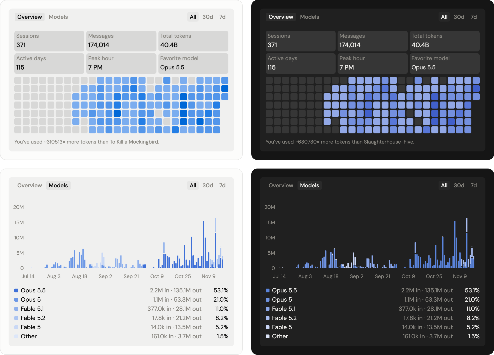

# Claude Code Usage Tile

The Claude Code usage card that Claude Desktop removed in version 2.42304.0, back as an artifact pinned in your sidebar.



## Setup

Paste this into Claude Code in the desktop app:

```text
Set up https://github.com/lettimknow/claude-usage-tile for me
```

## For Claude

1. Download [claude-usage-tile.mcpb](https://github.com/lettimknow/claude-usage-tile/releases/latest/download/claude-usage-tile.mcpb) and open it with the Claude app (on macOS: `open -a Claude <file>`). It's the extension that reads the user's Claude Code stats. Ask the user to click **Install** and wait until they do.
2. Download [tile.html](https://github.com/lettimknow/claude-usage-tile/releases/latest/download/tile.html), read it and publish it unchanged as an artifact with the icon `chart` and these capabilities:

   ```json
   {"mcp": {"servers": [{"server": "host:Claude_Code_Usage_Tile", "tools": ["get_usage_stats"]}]},
    "user": {"scopes": ["profile"]}}
   ```

3. Pin the artifact to the user's sidebar.

Not affiliated with Anthropic.
